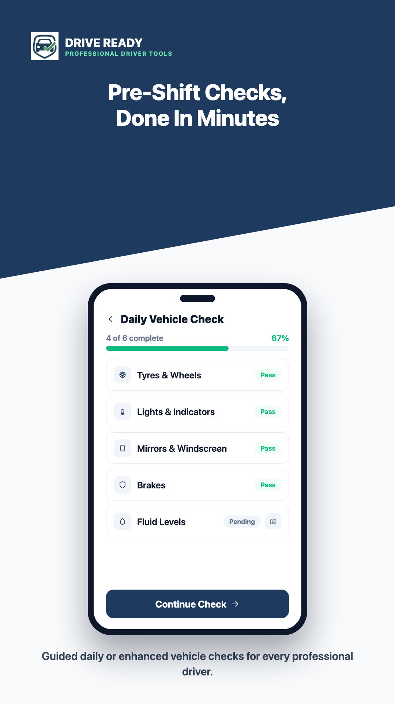
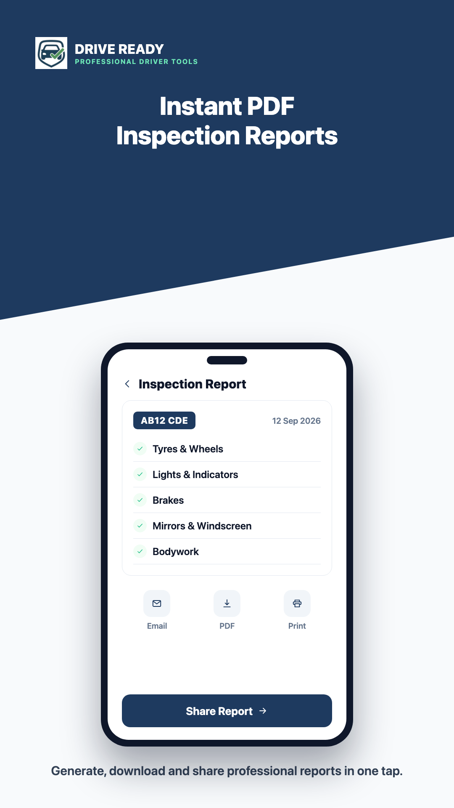
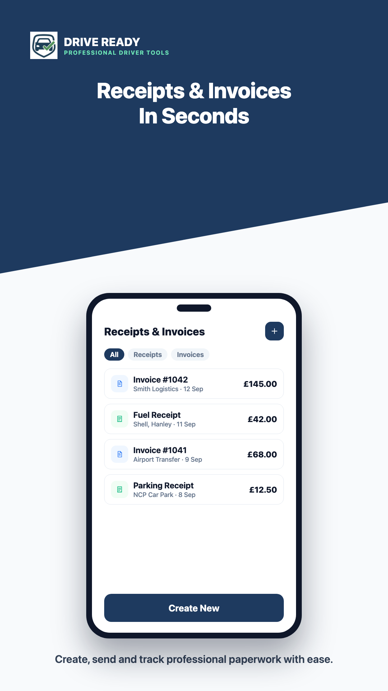
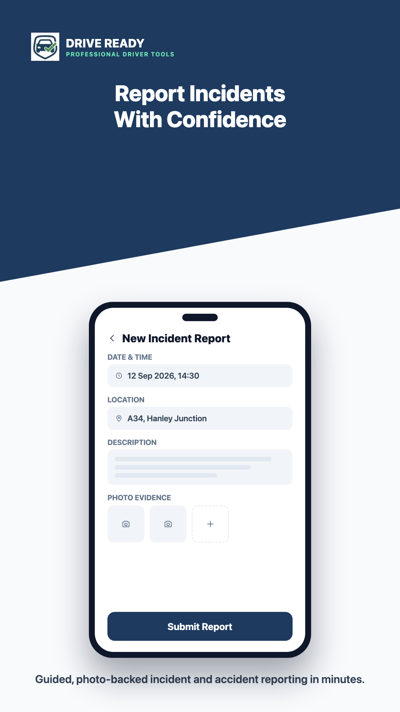
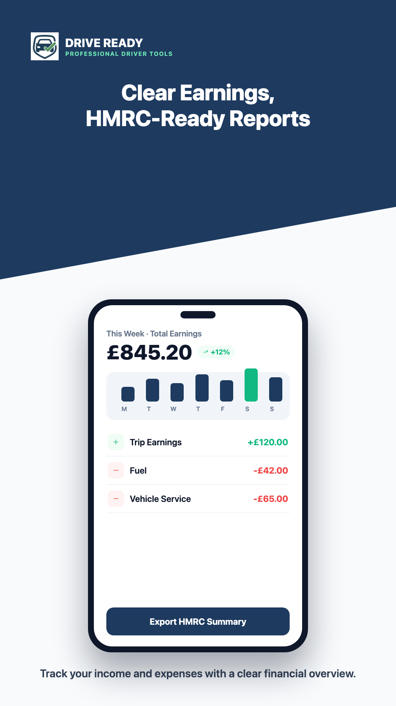

# Drive Ready

Professional driver tools for UK drivers, live on Google Play. Drive Ready turns daily vehicle checks, inspection reports, receipts, and earnings tracking into a few taps.

I built the mobile app end to end on React Native and shipped it to the Play Store.

**Live on Google Play:** https://play.google.com/store/apps/details?id=com.driveready.app

## What it does

- **Pre-shift vehicle checks.** Guided daily or enhanced checks with pass and fail status and photo evidence.
- **Instant PDF inspection reports.** Generate, download, and share a professional report in one tap.
- **Receipts and invoices.** Create, send, and track paperwork for jobs in seconds.
- **Incident reporting.** Photo-backed incident and accident reports with date, location, and notes.
- **Earnings tracking.** A clear weekly view of income and expenses with an HMRC-ready export.

## Screenshots

  
  
  
  

## Built with

- React Native
- Firebase for messaging and notifications
- Stripe for payments
- PDF generation and sharing

## Note

Drive Ready is live and free on Google Play. The source code is private. This page shows the product and my role on it.

Built by Hawa Yasir.

[LinkedIn](https://www.linkedin.com/in/hawa-yasir-6328b5255) and [GitHub](https://github.com/hawa-yasir)
